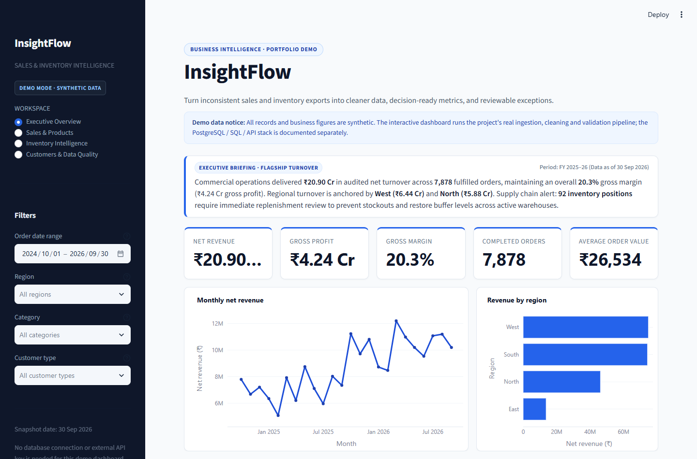
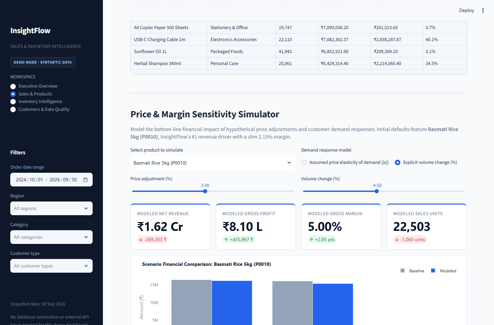
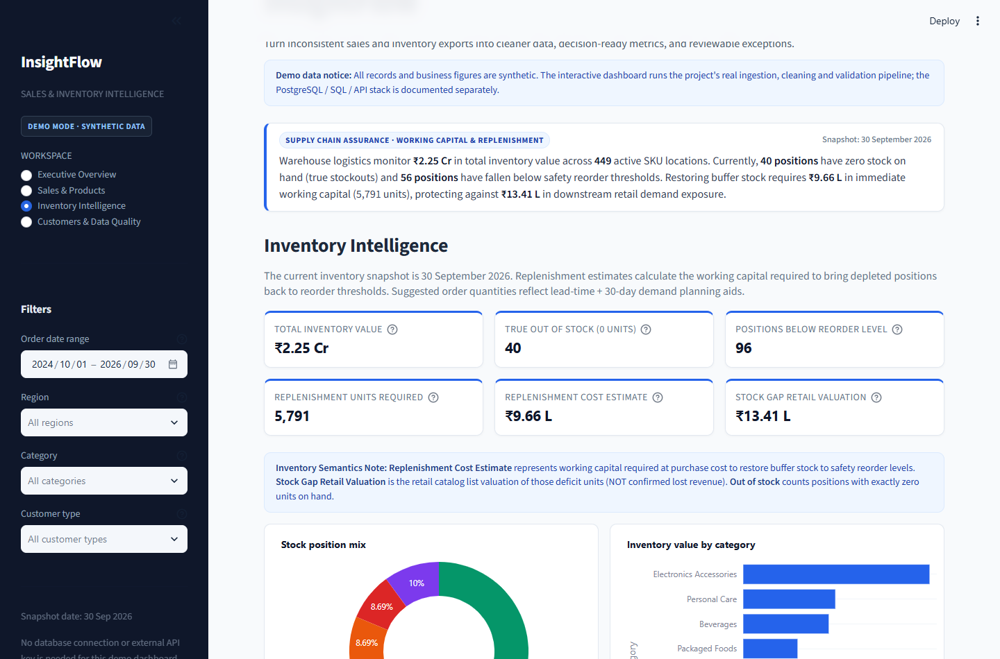
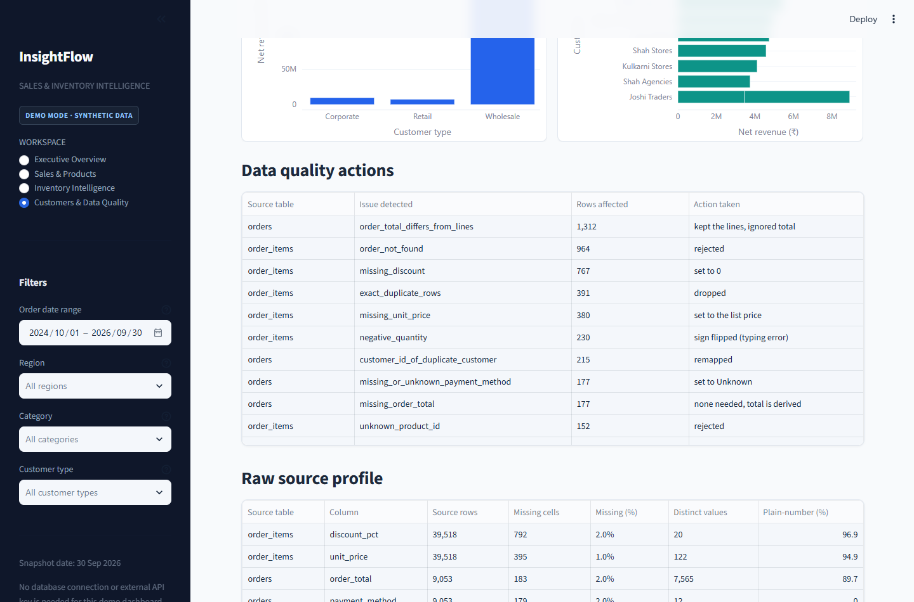
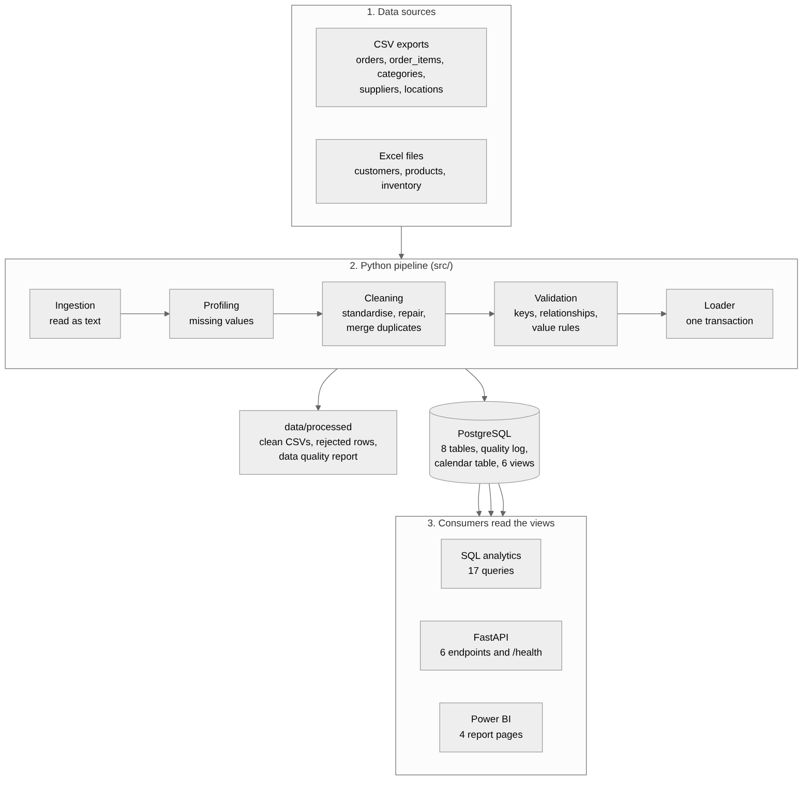
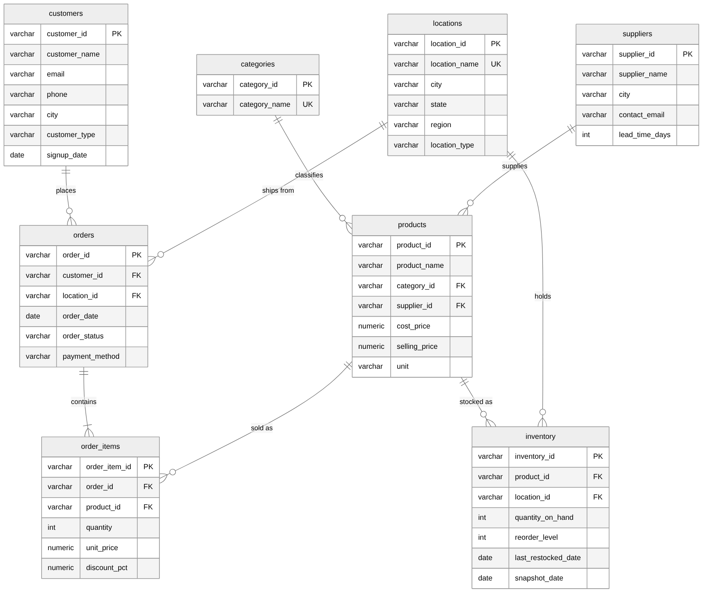
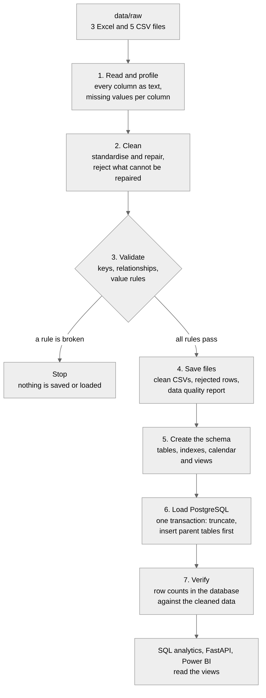

# InsightFlow — Sales & Inventory Intelligence

InsightFlow turns messy retail and distribution exports into cleaner data, decision-ready sales and
inventory metrics, and reviewable exceptions. It combines an **interactive Streamlit demo dashboard**,
a Python data-quality pipeline, PostgreSQL schema and views, 17 SQL analytics queries, a FastAPI
service, and a documented Power BI reporting design.

- **Run the interactive dashboard:** `streamlit run streamlit_app.py` — synthetic data only; no
  PostgreSQL service or credentials needed.
- **Explore the engineering stack:** run the pipeline and API against PostgreSQL, or use Docker Compose.
- **Data privacy:** the included source records are generated synthetic examples, not business or customer data.

The data is synthetic and deliberately messy, so the project can show the full path from a bad
export to a trusted number: clean the files, check them, load PostgreSQL, answer business
questions in SQL, serve them through an API and show them in a dashboard.

Contents: [Problem](#the-problem) | [What it does](#what-it-does) | [Interactive dashboard](#interactive-demo-dashboard) | [Architecture](#architecture) |
[Stack](#technology) | [Database](#database) | [Pipeline](#data-pipeline) |
[SQL](#sql-analytics) | [Power BI](#power-bi) | [API](#api) | [Run it](#how-to-run-the-full-backend) |
[Insights](#example-business-questions-and-what-the-data-shows) | [Tests](#tests) |
[Limits](#limits) | [Next steps](#future-improvements) | [Docs](#documentation)

## The problem

The business has 8 locations (stores and warehouses), 60 products from 12 suppliers and 800
customers. Orders and stock levels are exported from different tools into spreadsheets. The
exports are what real exports look like: names in three spellings, dates in three formats,
prices stored as `₹1,676.60`, the same customer registered twice, orders that point at a
customer that does not exist, and totals that do not match their lines.

The owner wants to know which products earn money, which customers matter, what is about to run
out and what is sitting unsold. Nobody can answer that reliably from the files. The same question
gives a different number depending on who built the spreadsheet.

## What it does

- **Creates the raw data.** `scripts/generate_synthetic_data.py` builds a clean data set, then
  damages it in 15,052 recorded ways (3 Excel files and 5 CSV files). It writes down what it
  broke, so the pipeline can be checked against the truth.
- **Cleans and checks it.** Text, dates and numbers are standardised. A value is repaired when
  the right answer is clear and the row is rejected, with a reason, when it is not. Every
  repair and rejection is counted in a quality report. Keys, relationships and value rules are
  validated before anything reaches the database.
- **Loads PostgreSQL.** Eight tables with primary keys, foreign keys and check constraints, ten
  indexes, a calendar table and six views that hold the business rules once.
- **Answers business questions in SQL.** 17 queries with CTEs, window functions, subqueries,
  `HAVING`, `CASE`, `FILTER` and `ROLLUP`. Each file explains why that technique was chosen.
- **Price & Margin Sensitivity Simulator.** An interactive scenario modeling engine in `src/analytics/demo.py`
  and Streamlit enabling pricing and elasticity stress-testing for high-volume products (such as Basmati Rice 5kg).
- **Data Assurance & Audit Workpaper.** A corporate Excel assurance model in `documentation/data_assurance_workpaper.xlsx`
  generated via `scripts/generate_data_assurance_workpaper.py` using `openpyxl`, featuring dynamic formulas and entity reconciliation.
- **Serves the numbers.** A FastAPI service with six analytics endpoints, validated parameters,
  typed responses, error handling and Swagger documentation.
- **Explores the results.** The interactive Streamlit demo has executive, sales/product, inventory,
  customer and data-quality views with filters and CSV exports. It runs against the cleaned synthetic
  dataset without a database connection.
- **Power BI Project (`InsightFlow.pbip`).** A version-controlled Microsoft Fabric / Power BI Desktop project
  with a star schema, 45+ DAX measures, local data extracts, and 4 report pages (`Executive Profitability`,
  `Margin Investigation`, `Inventory Decisions`, `Data Integrity & Pipeline Assurance`).
- **Tests what matters.** 161 automated tests passing without PostgreSQL (69 database tests skipped when offline; 230 total) covering data cleaning rules, inventory replenishment boundaries,
  price sensitivity modeling, Excel workpaper integrity, and PBIP semantic model structures. Some database tests require PostgreSQL.

## Interactive demo dashboard

Run the working interactive dashboard locally with no database credentials:

```bash
python -m venv .venv
# Windows PowerShell: .\.venv\Scripts\Activate.ps1
# macOS / Linux:      source .venv/bin/activate
python -m pip install -r requirements.txt
streamlit run streamlit_app.py
```

The first load profiles and cleans the included synthetic CSV/XLSX files using the same ingestion,
cleaning and validation pipeline used by the full backend, then caches the result during the session.
The dashboard includes an executive overview, monthly sales and margin trends, category and product
performance, stock-status review queues, customer summaries, raw-data profiling and quality-action logs.
Date, region, category and customer-type filters update the analysis; selected results can be exported
to CSV.

This is a **demo interface**, not a claim that any real business uses the figures. Calculations in the
Pandas demo are kept alongside tests; the PostgreSQL views remain the canonical source for the API and
full SQL workflow. The demo can be deployed independently on Streamlit Community Cloud by selecting
`streamlit_app.py` as the app entry point after the repository is pushed to GitHub. No secrets are
needed for this synthetic-data demo. Authentic runtime screenshots are captured directly from the running app
and saved under `screenshots/runtime/` alongside automated UI QA validation results (`ui_qa_results.json`).

### Streamlit runtime dashboard previews

Direct browser captures of all four pages running on synthetic data:

| Executive Overview | Sales & Products |
|---|---|
|  |  |
| **Price Sensitivity Simulator** | **Inventory Intelligence** |
|  |  |
| **Customers & Data Quality** | |
|  | |

## Architecture



Raw files go through the Python pipeline into PostgreSQL. The views in the database define net
revenue, gross profit, stock status and the customer segments once. The SQL queries, the API
and Power BI all read those views, so they show the same numbers. More in
[architecture.md](documentation/architecture.md) and [data_flow.md](documentation/data_flow.md).

## Technology

| Part | Used for |
|---|---|
| Python 3.13 | pipeline, API, tests |
| pandas 3.0, NumPy 2.5, openpyxl | reading, cleaning and checking the data |
| PostgreSQL 16, SQLAlchemy 2.1, psycopg2 | storage and SQL |
| FastAPI, Pydantic, Uvicorn | the PostgreSQL-backed API |
| Streamlit, Plotly | the interactive no-database demo dashboard |
| pytest, httpx | tests |
| ruff, black | formatting and linting |
| Power BI Desktop | interactive 4-page report deliverable (`powerbi/InsightFlow.pbip`), star schema semantic model, and 45+ DAX measures |
| Git | version control |

These are the versions the project was built and tested with, on Linux. `requirements.txt` allows
a range for each package.

## Database



| Table | Rows loaded | Content |
|---|---|---|
| categories | 8 | product categories (7 and `Uncategorized`) |
| suppliers | 12 | supplier and lead time in days |
| locations | 8 | stores and warehouses with a region |
| products | 60 | category, supplier, cost and selling price |
| customers | 800 | Retail, Wholesale or Corporate |
| orders | 8,734 | one row per order; Completed, Cancelled or Returned |
| order_items | 37,744 | one row per product on an order |
| inventory | 449 | one stock snapshot (30 September 2026) |

Besides these, `etl_quality_log` stores what the pipeline found and `dim_date` is a calendar
table for Power BI. Six views (`vw_fact_sales`, `vw_fact_inventory`, `vw_dim_product`,
`vw_dim_customer`, `vw_dim_location`, `vw_customer_segments`) hold the formulas. The columns,
constraints, indexes and view rules are in [database_schema.md](documentation/database_schema.md).

## Data pipeline



1. Read the eight files with every column as text, and profile the missing values.
2. Clean each table in the order of its dependencies. Fix, fill or reject, and log it.
3. Validate keys, relationships, required columns and value rules. Stop on any failure.
4. Write the clean tables, the rejected rows and the reports to `data/processed`.
5. Create the schema, load PostgreSQL in one transaction and compare the row counts.

What it does to the raw files in this repository:

| Table | Raw rows | Loaded | Why the rest is gone |
|---|---|---|---|
| customers | 848 | 800 | 8 exact duplicates, 40 customers registered twice and merged |
| products | 63 | 60 | 3 exact duplicates |
| orders | 9,053 | 8,734 | 107 exact duplicates, 212 rejected (bad date, unknown customer or location, no valid line) |
| order_items | 39,518 | 37,744 | 391 exact duplicates, 1,383 rejected (order missing, unknown product, bad quantity) |
| inventory | 463 | 449 | 14 rejected (unknown product, stale second row) |

The pipeline recovers all 800 customers, 97.6% of the completed orders and 96.7% of the revenue
of the data before it was damaged. About 3.3% of revenue is lost because rows that cannot be
repaired are rejected, not guessed. [data_quality.md](documentation/data_quality.md) lists every
problem, every action and the judgement calls (for example a missing discount is set to 0).

## SQL analytics

The 17 queries are in `sql/analytics/`. Each starts with the question and the reason for the
technique.

| Topic | Queries |
|---|---|
| Sales | 01 monthly revenue, 02 monthly growth, 03 top products, 05 category performance, 06 profit margins, 07 average order value, 12 regional performance, 14 product ranking, 15 month over month comparison |
| Customers | 04 top customers, 08 repeat customers, 13 customer segmentation |
| Inventory | 09 inventory turnover, 10 slow moving products, 11 low stock products, 16 inventory and sales mismatch |
| Orders | 17 order status mix |

```bash
python scripts/run_analytics.py                # run all of them
python scripts/run_analytics.py --only 05 11   # run some
python scripts/run_analytics.py --export       # also write CSV files
```

Results and the reasoning for each query are in [sql_analytics.md](documentation/sql_analytics.md).

## Power BI Project (`InsightFlow.pbip`)

InsightFlow includes a version-controlled **Power BI Project (`powerbi/InsightFlow.pbip`)** built to modern PBIP, TMDL, and PBIR developer specifications.

Instead of an opaque binary `.pbix` file, the tabular semantic model and report visuals are decomposed into human-readable, Git-versioned TMDL and JSON structures (`InsightFlow.SemanticModel` and `InsightFlow.Report`), enabling automated CI/CD validation, branch diffing, and reproducible local desktop execution.

> **Quick Start for Fresh Clones (No PostgreSQL required):** The production CSV extracts are generated directly from the included raw synthetic data:
> ```bash
> python scripts/run_pipeline.py --skip-db
> python scripts/export_powerbi_data.py
> ```
> Then open `powerbi/InsightFlow.pbip` in [Microsoft Power BI Desktop](https://powerbi.microsoft.com/desktop/) on Windows. If prompted or if the project folder was relocated on your workstation, configure the **`DataFolder`** parameter to your local `powerbi/data` directory via **Home > Transform data > Edit parameters** (or run `python scripts/build_powerbi_pbip.py` to auto-detect your local path), then click **Home > Refresh**. For an immediate interactive web demo without installing desktop software, launch the [Streamlit Live Demo](https://insightflow-portfolio.streamlit.app/).

### Dimensional Model Architecture

The semantic model implements a validated single-direction star schema centered on two fact tables (`Sales` and `Inventory`) with four core dimensions (`Date`, `Product`, `Customer`, `Location`) and a dedicated pipeline assurance matrix (`DataQualityReconciliation`):


- **Star Schema Integrity:** Four core dimensions (`Product`, `Customer`, `Location`, `Date`) filter facts via 1:N single-direction relationships with 100% foreign key coverage across all 34,007 sales records.
- **Calculated at Source:** Net revenue, gross margins, inventory health statuses, and customer RFM profiles are standardized across PostgreSQL views, Streamlit, and Power BI DAX.
- **Continuous Date Calendar:** Marked `Date` dimension with 1,004 days (2024-01-01 to 2026-09-30) supporting time-intelligence measures with 100% key alignment to `Sales.order_date`.
- **Type-Safe Data Quality Reconciliations:** Standalone verification entity tracking raw ingestion against clean loads with automated checksum validation.

---

### Genuine Power BI Desktop Runtime Previews

Captured directly from the active, fully refreshed Power BI Desktop instance via the Power BI Desktop Bridge CLI (`@microsoft/powerbi-desktop-bridge-cli`):

#### 1. Executive Profitability
*Focus: Commercial performance, 24-month revenue trajectories, margin health, and category revenue distribution.*
- **Audited Metrics:** ₹209.03M Net Revenue · ₹42.36M Gross Profit · 20.3% Gross Margin · 7,878 Completed Orders · ₹26,534 AOV
- **Visuals:** 24-Month Monthly Revenue Trend (continuous 2024-10 to 2026-09 trajectory) & Net Revenue by Category (Electronics Accessories, Personal Care, Packaged Foods leading).


---

#### 2. Margin Investigation & Flagship Elasticity
*Focus: Revenue-versus-profit dynamics, supplier margin ranking, and price sensitivity stress testing.*
- **Audited Metrics:** ₹16.53M Basmati Net Revenue · ₹354K Gross Profit · 2.15% Flagship Margin · 58.3% Break-Even Volume Tolerance (+3% price)
- **Visuals:** Product Net Revenue vs Gross Profit scatter plot & Gross Margin % by Supplier (ranging from 3.2% Golden Harvest to 35.4% Skyline Cosmetics).


---

#### 3. Inventory Decisions & Capital Replenishment
*Focus: Working capital allocation, out-of-stock exposure, and replenishment prioritization queue.*
- **Audited Metrics:** ₹22.49M Total Stock Valuation · 40 Stockout Positions · 96 Positions Below Reorder · ₹966K Capital Required to Replenish · ₹1.34M Catalog Stock Gap
- **Visuals:** Stock Positions by Health Status mix (Healthy, Overstocked, Stock-out risk, Out of stock, Low stock) & Priority Stock Replenishment Queue table.


---

#### 4. Data Integrity & Pipeline Assurance
*Focus: Operational data governance, entity-by-entity record reconciliation, and data preservation rates.*
- **Audited Metrics:** 49,975 Raw Records Ingested · 47,814 Clean Records Loaded · 512 Duplicates Dropped · 1,609 Quarantined/Rejected · 40 Merged Profiles · 95.7% Preservation Rate
- **Visuals:** High-level conservation KPI cards & Complete End-to-End Pipeline Reconciliation Matrix across all 8 operational entities (all balanced: $\text{Raw} - \text{Duplicates} - \text{Quarantined} - \text{Merged} = \text{Clean}$).


## API

```bash
uvicorn api.main:app --reload
```

Swagger UI is at http://localhost:8000/docs.

| Endpoint | Returns |
|---|---|
| `GET /sales/summary` | revenue, profit, margin, orders, customers, average order value, units, stock value |
| `GET /sales/monthly` | revenue, profit, margin and growth for each month |
| `GET /products/top` | best selling products by revenue, profit or units |
| `GET /inventory/low-stock` | stock that is out, will run out before a delivery or is at the reorder level, with a suggested order |
| `GET /customers/top` | highest spending customers and their share of revenue |
| `GET /analytics/category-performance` | revenue, margin and 12 month trend per category |
| `GET /health` | whether the API can reach the database |

```bash
curl "http://localhost:8000/products/top?metric=profit&limit=3"
curl "http://localhost:8000/sales/summary?start_date=2026-01-01&end_date=2026-03-31&location_id=L01"
```

Dates, ids, limits and statuses are validated (a bad value gives `422`, an unknown location gives
`404`, an unreachable database gives `503`). Parameters reach PostgreSQL as bound values. See
[api.md](documentation/api.md) for the parameters, sample responses and error format.

## How to run the full backend

The interactive Streamlit demo is described above and does not need PostgreSQL. For the full
PostgreSQL-backed pipeline, SQL analytics and FastAPI service, use one of the following routes.
Python 3.11 or newer is required; the project has been documented/tested for Python 3.13 and PostgreSQL 16.
The synthetic raw data files are included in the repository.

**Option A — Docker Compose (recommended for a local backend demo)**

Docker Compose creates a local PostgreSQL database, loads the synthetic dataset, and starts the API:

```bash
docker compose up --build
```

Open `http://localhost:8000/docs` for the API's Swagger UI. The Compose configuration resets and
reloads this project's **synthetic demo database** when its seeding service runs. Do not reuse this
configuration for valuable or production data. Stop it with `docker compose down`; add `-v` only if
you intentionally want to remove the local demo database volume.

**Option B — install and configure PostgreSQL manually**

**1. Install**

```bash
git clone https://github.com/meetpokal1/InsightFlow.git InsightFlow
cd InsightFlow
python -m venv .venv
source .venv/bin/activate          # Windows: .venv\Scripts\activate
pip install -r requirements.txt
```

**2. Create the databases** (once, as the PostgreSQL superuser, for example `psql -U postgres`)

```sql
CREATE USER sales_user WITH PASSWORD 'choose-a-password';
CREATE DATABASE sales_intelligence OWNER sales_user;
CREATE DATABASE sales_intelligence_test OWNER sales_user;
```

The second database is only for the tests.

**3. Configure**

```bash
cp .env.example .env               # Windows: copy .env.example .env
```

Open `.env` and set `DB_PASSWORD`. `.env` is git-ignored. Do not commit it.

**4. Run the pipeline**

```bash
python scripts/run_pipeline.py --as-of 2026-09-30
```

This cleans the raw files, writes the results to `data/processed`, creates the schema and loads
PostgreSQL. The `--as-of` date is the day after which an order counts as impossible. The default
is today's date. Giving the date makes the run repeat exactly. Useful options: `--skip-db` stops
before the database, `--reset-schema` drops the tables first.

**5. Use the result**

```bash
python scripts/run_analytics.py            # the SQL analysis
uvicorn api.main:app --reload              # the API, docs at http://localhost:8000/docs
python scripts/export_powerbi_data.py      # only for the CSV route into Power BI
```

**6. Run the tests**

```bash
python -m pytest
ruff check .
ruff format --check .
```

PostgreSQL-dependent tests use a separate `sales_intelligence_test` database. The repository's GitHub
Actions workflow provisions PostgreSQL 16, creates that isolated test database, then runs the suite and
style checks on pushes and pull requests. For a local full-suite run, create the test database described
above before running `pytest`; data-loading tests rebuild only the isolated test schema.

The tests that need PostgreSQL use the separate database (`DB_NAME` plus `_test`, or
`TEST_DB_NAME`). In a local environment without a running database, those tests are skipped after the
PostgreSQL driver is installed; the synthetic-data cleaning and dashboard-calculation tests can run
without PostgreSQL.

**Your own data.** Put one CSV or Excel file per table in `data/raw`, named like the tables. The
columns are the ones in [database_schema.md](documentation/database_schema.md), and `orders`
also needs `order_total`. A missing column stops the run with a message that names it.

## Example business questions and what the data shows

The figures come from the synthetic dataset (October 2024 to September 2026). They show what
the system returns. They are not findings about a real business.

| Question | Where | What the data shows |
|---|---|---|
| Is the business growing? | SQL 02, 05; `/sales/monthly`; page 1 | The last 12 months brought in 124.47M, 47.2% more than the 12 months before (84.57M). A single month moves between -21.6% and +55.9%, so one month says little. |
| Which products earn the most, and which sell a lot but earn little? | SQL 03, 06; `/products/top`; page 2 | Basmati Rice 5kg is the top seller (16.47M, 7.9% of revenue) at a 2.1% margin against 20.3% for the company. 13 products sell at least the median revenue with a below-average margin. The Wireless Mouse earns the most profit (2.98M at 25.8%). |
| How dependent is the business on a few customers? | SQL 04, 07, 13; `/customers/top` | 136 wholesale customers out of 780 buyers bring 91.8% of revenue. The top 10 customers are 20.05% and the top 20 are 32.78%, all wholesale. The average wholesale order is 44,244, a retail order 2,703. |
| Which customers should be won back? | SQL 13; page 4 | 111 "At risk" customers averaged 7.6 orders and last ordered 154 days before the end of the data. The 173 "Lost" customers are 0.3% of revenue. |
| What will run out? | SQL 11; `/inventory/low-stock`; page 3 | 92 of 449 stock positions need action: 39 are out of stock, 39 will run out before a delivery could arrive and 14 are at the reorder level. Their suggested orders add up to 13,184 units. |
| Where is money tied up in stock? | SQL 09, 10, 16; page 3 | 45 overstocked positions hold 12.69M, 56.4% of the 22.49M stock value. Stock turns 4.41 times a year (83 days of inventory). |
| Do stock and sales disagree? | SQL 16 | 39 out-of-stock positions sold 2.42M (at list price) in the last 90 days. 30 product and location pairs sold 1.69M with no stock record. |
| What do cancellations and returns cost? | SQL 17 | 6.1% of orders were cancelled (529) and 3.7% returned (327). Their value, 24.08M, is not counted as revenue. |

The KPI formulas are in [kpi_definitions.md](documentation/kpi_definitions.md).

## Tests

```bash
python -m pytest tests/ -k "not test_database and not test_api" -v
```

161 automated unit tests pass without requiring a running database service (69 database/API tests skipped when offline; 230 total):

| Area | What is checked | Test Module |
|---|---|---|
| Cleaning rules | One test file per table: text, dates, numbers, duplicates, outliers, missing values | `tests/test_clean_*.py` |
| Pipeline | 90%–100% injected defects remediated; raw-to-clean conservation law verified | `tests/test_pipeline.py` |
| Inventory Semantics | Replenishment capital required vs stock gap retail valuation; true zero-stock boundary cases | `tests/test_inventory_metrics.py` |
| Price Sensitivity | P0010 Basmati Rice case study; break-even volume tolerance (58.3%); demand elasticity modeling | `tests/test_price_sensitivity.py` |
| Assurance Workpaper | Excel workpaper generation; dynamic formulas; formula injection security | `tests/test_workpaper.py` |
| Power BI (PBIP) | Multi-page report schema; DAX measures; star schema relationships; local CSV feeds | `tests/test_powerbi_deliverable.py` |
| Database & SQL | Schema constraints; view consistency; analytical query math (run with PostgreSQL) | `tests/test_database.py`, `tests/test_analytics_sql.py` |
| API | Endpoint schemas; parameter validation; error formatting (run with PostgreSQL) | `tests/test_api.py` |

The tests compare results with a calculation made in another way, so an error in a view or a
query shows up. The ruff checks must also pass (`ruff check .` and `ruff format --check .`).

## Limits

- The data is synthetic. The insights describe the generated data, not a real business.
- Cost of goods uses the current cost price, because the data has no cost history.
- Stock is one snapshot. Turnover uses it in place of an average, and there is no stock trend.
- A missing discount is set to 0 and two missing cost prices are estimated. These are
  approximations and they are logged.
- The pipeline replaces all tables on every run. It does not load increments.
- The API is read-only, has no login and is meant for local/demo use unless authentication and deployment hardening are added.
- Built and tested on Linux with Python 3.13 and PostgreSQL 16 only.

## Future improvements

- Incremental loads and a scheduler, so the pipeline runs without being started by hand.
- Monthly stock snapshots, for real turnover and stock trends.
- A cost price history, so old orders carry the cost of their time.
- Authentication, pagination and caching for the API.
- Demand forecasting and safety stock in the suggested order quantity.
- Deploy the PostgreSQL-backed API beyond local Docker Compose if a secure, maintainable hosted database is available.

## Project structure

```
InsightFlow/
├── streamlit_app.py            interactive synthetic-data dashboard (no database required)
├── .streamlit/config.toml      dashboard theme defaults
├── Dockerfile                  API container image
├── .dockerignore               excludes local secrets, caches and generated data
├── docker-compose.yml          local PostgreSQL + data load + API
├── .github/workflows/tests.yml PostgreSQL-backed CI test suite
├── documentation/antigravity_release_guide.md  local publish and screenshot runbook
├── data/
│   ├── raw/                  messy input files (3 Excel, 5 CSV) and the generation manifest
│   └── processed/            pipeline output (not committed)
├── src/
│   ├── ingestion/            read the raw files, profile them
│   ├── cleaning/             one cleaner per table, rules, validators, quality log
│   ├── database/             connection, schema runner, loader
│   ├── analytics/            SQL runner, API queries and pandas demo calculations
│   ├── synthetic/            the raw data generator
│   ├── pipeline.py           the full run
│   ├── tables.py             tables, columns, keys
│   └── config.py             settings from the environment
├── sql/
│   ├── schema/               tables, indexes, calendar table, views
│   └── analytics/            the 17 queries
├── api/
│   ├── routes/               one file per group of endpoints
│   ├── schemas/              Pydantic response models
│   ├── dependencies.py       connection, date range, id checks
│   └── main.py               the FastAPI app
├── powerbi/                  version-controlled PBIP report, semantic model, DAX, queries, and theme
│   ├── InsightFlow.pbip      Power BI Project entry point (double-click in Windows)
│   ├── InsightFlow.Report/   Fabric PBIR visual layer definitions and queryState bindings
│   ├── InsightFlow.SemanticModel/ Tabular model (model.bim), star schema, and 45+ DAX measures
│   └── data/                 production CSV extracts generated for offline desktop loading
├── documentation/            architecture, data flow, schema, API, KPIs, data quality, workpapers
│   └── diagrams/             Mermaid sources and PNG images
├── scripts/                  pipeline runner, analytics, PBIP builder, data assurance export
├── tests/                    pytest suite, PBIP deliverable, and assurance tests
├── screenshots/
│   ├── powerbi/              genuine Power BI Desktop report pages and semantic model captures
│   └── runtime/              genuine Streamlit browser captures and automated UI QA results JSON
├── .env.example
├── .gitignore
├── pyproject.toml            ruff, black and pytest settings
├── requirements.txt
└── README.md
```

## Documentation

| Document | Content |
|---|---|
| [architecture.md](documentation/architecture.md) | the parts, the folders and the design decisions |
| [data_flow.md](documentation/data_flow.md) | the pipeline step by step, options and output files |
| [er_diagram.md](documentation/er_diagram.md) | the relationships and design notes |
| [database_schema.md](documentation/database_schema.md) | every table, index and view |
| [data_quality.md](documentation/data_quality.md) | what was wrong, what was done, what was lost |
| [sql_analytics.md](documentation/sql_analytics.md) | the 17 queries, their techniques and results |
| [api.md](documentation/api.md) | endpoints, parameters, responses and errors |
| [kpi_definitions.md](documentation/kpi_definitions.md) | every KPI with its SQL, API and Power BI source |
| [concepts_to_know.md](documentation/concepts_to_know.md) | the ideas behind the code, how to change it, practice questions |
| [antigravity_release_guide.md](documentation/antigravity_release_guide.md) | safe GitHub publishing, local execution and genuine screenshot capture |
| [powerbi/README.md](powerbi/README.md) | building the Power BI report |
