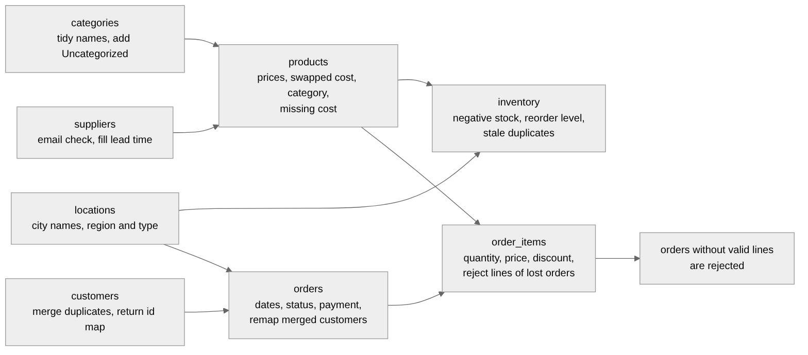

# Data flow

Run it with `python scripts/run_pipeline.py`. The steps are the same every time.

| Step | What happens | Code |
|---|---|---|
| 1. Read and profile | The eight files are read with every column as text. Missing values per column are counted and logged. | `src/ingestion/loader.py`, `profiling.py` |
| 2. Clean | Each table is standardised and repaired. Rows that cannot be repaired are rejected with a reason. Every change is counted in the quality log. | `src/cleaning/` |
| 3. Validate | Column names, primary keys, required columns, foreign keys and value rules are checked on the cleaned tables. One broken rule raises `DataValidationError` and the run ends here. | `src/cleaning/validators.py` |
| 4. Save files | Clean tables, rejected rows, the quality report and the raw data profile are written to `data/processed`. | `src/pipeline.py` |
| 5. Create the schema | The files in `sql/schema` run in order. They use `IF NOT EXISTS` (and drop and recreate the views), so they are safe to run again. | `src/database/connection.py` |
| 6. Load PostgreSQL | One transaction: `TRUNCATE`, then insert the tables with parents before children. The quality log is appended afterwards. | `src/database/loader.py` |
| 7. Verify | The row count of every table in PostgreSQL is compared with the cleaned data. A difference raises an error. | `src/database/loader.py` |

Options of `scripts/run_pipeline.py`:

| Option | Effect |
|---|---|
| `--skip-db` | Stop after step 4. Useful to look at the cleaned files without a database. |
| `--reset-schema` | Drop all project tables first. Needed after a table definition changes. |
| `--as-of 2026-10-01` | Orders dated after this day count as invalid. The default is today, or `AS_OF_DATE` from `.env`. |
| `--raw-dir`, `--processed-dir` | Read from or write to other folders. |

## Order of the cleaning step

The tables are cleaned in the order of their dependencies, because a later table is checked
against the clean version of an earlier one:

| Table | Needs first | Why |
|---|---|---|
| products | categories, suppliers | a product must point to an existing category and supplier |
| customers | none | returns a map of merged duplicate ids |
| orders | customers, locations | the customer must exist, and orders of merged duplicates are moved to the kept customer |
| order_items | orders, products | a line needs an existing order and product, and its price is compared with the product price |
| orders (again) | order_items | an order whose lines were all rejected is rejected too |
| inventory | products, locations | stock rows need an existing product and location |

## What each file contains

| File in `data/processed` | Content |
|---|---|
| `categories.csv` ... `inventory.csv` | The eight clean tables, exactly as loaded into PostgreSQL |
| `rejected/<table>_rejected.csv` | Rows that were not loaded, with the original row number (`source_row`) and `reject_reason`. Only created for tables that had rejects. |
| `data_quality_report.csv` | One row per problem type and table: how many rows, and what was done |
| `raw_data_profile.csv` | Rows, missing values and distinct values per column of the raw files |

The same quality findings are also loaded into the `etl_quality_log` table, with the time of
the run, so the history of runs can be queried in SQL. The numbers from the current dataset
are in [data_quality.md](data_quality.md).
