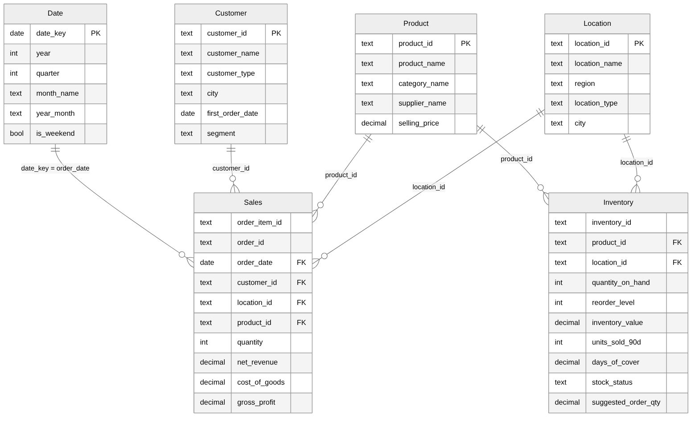

# Power BI Deliverable

InsightFlow includes a modern, version-controlled **Power BI Project (`InsightFlow.pbip`)** structured according to Power BI Desktop (PBIP) and PBIR developer standards.

Instead of an opaque binary `.pbix` file, the report and tabular semantic model are decomposed into text-based JSON/BIM artifacts (`InsightFlow.Report` and `InsightFlow.SemanticModel`), allowing Git version control, branch diffing, and automated CI/CD validation.

| Deliverable Artifact | Description |
|---|---|
| `InsightFlow.pbip` | Modern Power BI Project entry point. Double-click to launch directly in Power BI Desktop. |
| `InsightFlow.Report/` | Report visual layer definition (`report.json`, `definition.pbir`) containing 4 interactive analytical pages. |
| `InsightFlow.SemanticModel/` | Tabular model definition (`model.bim`, `definition.pbism`) containing the star schema, relationships, and 45+ DAX measures. |
| `data/*.csv` | Production CSV extracts (`vw_fact_sales.csv`, `vw_fact_inventory.csv`, `vw_dim_product.csv`, `vw_dim_customer.csv`, `vw_dim_location.csv`, `dim_date.csv`, `data_assurance_reconciliation.csv`). |
| [dax_measures.md](dax_measures.md) | Canonical DAX measures with mathematical formulas, business logic, and reconciliation benchmarks. |
| [report_pages.md](report_pages.md) | Visual-by-visual layout specifications for all 4 pages. |
| `theme.json` | Corporate color palette, accessible contrast ratios, and typography specifications. |
| `star_schema.mmd`, `star_schema.png` | Architecture diagrams of the underlying dimensional model. |

## Quick Start — How to Open in Power BI Desktop

1. **Pre-requisite:** Ensure [Microsoft Power BI Desktop](https://powerbi.microsoft.com/desktop/) is installed on Windows.
2. **Open the Project:**
   - Double-click `powerbi/InsightFlow.pbip`, or open Power BI Desktop and select **File > Open report** > navigate to `powerbi/InsightFlow.pbip`.
3. **Data Refresh & Source Configuration (`DataFolder` Parameter):**
   - The tabular model resolves CSV extracts via a shared Power Query text parameter named **`DataFolder`** (configured to the absolute path of the local `powerbi/data` folder).
   - Click **Home > Refresh** to load all records into memory.
   - **Moving to another computer / folder:** If the project directory is relocated:
     1. In Power BI Desktop, click **Home > Transform data > Edit parameters**.
     2. In the parameter dialog, enter the new absolute path to your `powerbi/data` folder (trailing backslash is optional; partition queries handle both formats automatically).
     3. Click **OK**, then click **Apply changes**.
     4. Alternatively, re-run `python scripts/build_powerbi_pbip.py` to auto-detect and update the path to the current machine.
   - Alternatively, connect directly to PostgreSQL views by updating the Power Query connection string in Power Query Editor as documented in [power_query.md](power_query.md).
4. **Inspect the 4 Interactive Pages:**
   - **Page 1: Executive Profitability:** High-level revenue (₹209.0M), gross profit (₹42.4M), margin (20.3%), order counts, monthly revenue line trend with prior-year comparisons, and category breakdown.
   - **Page 2: Margin Investigation:** Margin scatter analysis, volume vs profit matrix, flagship case study (**Basmati Rice 5kg / P0010** showing 2.15% margin and 58.3% break-even volume tolerance), and supplier concentration.
   - **Page 3: Inventory Decisions:** Stock value (₹22.49M), true out-of-stock count (40 positions), positions below reorder level (96 positions), **Replenishment Cost Estimate** (₹9.66 L working capital required), and **Stock Gap Retail Valuation** (₹13.41 L catalog valuation).
   - **Page 4: Data Integrity & Pipeline Assurance:** Complete pipeline reconciliation matrix verifying $Raw (49,975) - Duplicates (512) - Quarantined (1,609) - Merged (40) = Clean (47,814)$, data preservation rates (95.7% overall), and audit sign-off metrics.

## Data model

A star schema has fact tables, which hold events and numbers, and dimension tables, which
describe them. A slicer on a dimension filters the facts.

| Table | Source | One row is | Role |
|---|---|---|---|
| Sales | `vw_fact_sales` | one line of a completed order | fact |
| Inventory | `vw_fact_inventory` | one product at one location in the stock snapshot | fact |
| Date | `dim_date` | one day | dimension |
| Product | `vw_dim_product` | one product, with its category and supplier | dimension |
| Customer | `vw_dim_customer` | one customer, with their RFM segment | dimension |
| Location | `vw_dim_location` | one store or warehouse | dimension |

Relationships. All are one to many, single direction (from the dimension to the fact), active.

| From (one) | To (many) |
|---|---|
| `Date[date_key]` | `Sales[order_date]` |
| `Product[product_id]` | `Sales[product_id]` |
| `Customer[customer_id]` | `Sales[customer_id]` |
| `Location[location_id]` | `Sales[location_id]` |
| `Product[product_id]` | `Inventory[product_id]` |
| `Location[location_id]` | `Inventory[location_id]` |

Why it is built like this:

- **The views do the work.** Net revenue, gross profit, stock status and the customer segments
  are calculated once in PostgreSQL ([database_schema.md](../documentation/database_schema.md)).
  The report only adds them up. SQL, the API and Power BI therefore show the same numbers.
- **`Product` and `Location` are shared by both facts.** A category or location slicer filters
  sales and stock together.
- **`Date` and `Customer` only reach `Sales`.** Stock is a single snapshot, so a date slicer
  does not change it, and the inventory page has no date slicer. A customer type slicer does
  not change stock either.
- **Only completed orders are loaded.** Cancelled and returned orders are not in the model. Their
  numbers are in `sql/analytics/17_order_status_mix.sql`. To report on them in Power BI, load the
  `orders` table too and relate it to `Date`, `Customer` and `Location`.
- **A separate calendar table.** Time intelligence (same month last year, year to date) needs a
  continuous date table, which the order lines do not provide.
- **Hide the key columns** of the fact tables in the Model view (right-click > Hide in report
  view) so nobody drags an id into a chart.

## Colours

`theme.json` sets eight series colours that Power BI uses in order. Keep the order: neighbouring
colours were checked against each other for colour-blind readers in this order. Single-series
charts use the first colour (blue). The pages as designed use no other series colour, because
the comparison line in the monthly revenue chart is grey. The green, gold and pink in the list
are too light to be read against the background without labels, so a chart that uses them
needs data labels or the table view.

Stock status has its own colours, set by hand on the charts that show it. The colour never
carries the meaning alone, because the status is always written out too (axis, legend or a
column). The icon rule in the product matrix shows the margin number next to the warning icon.

| Meaning | Colour |
|---|---|
| Good, healthy | `#0CA30C` |
| Warning, low stock | `#FAB219` |
| Serious, stock-out risk | `#EC835A` |
| Critical, out of stock | `#D03B3B` |
| Overstocked | `#2A78D6` |
| No data, no recent sales | `#898781` |

The theme file was not loaded into Power BI Desktop where it was written. If Power BI reports
an error when importing it, delete the `visualStyles` block. The colours and fonts then still
apply, and you can set backgrounds and borders by hand.
